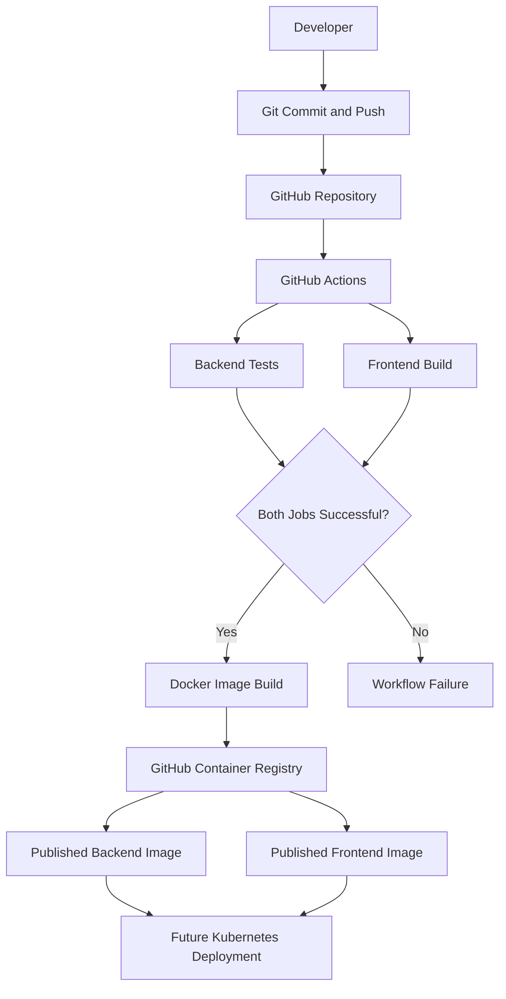
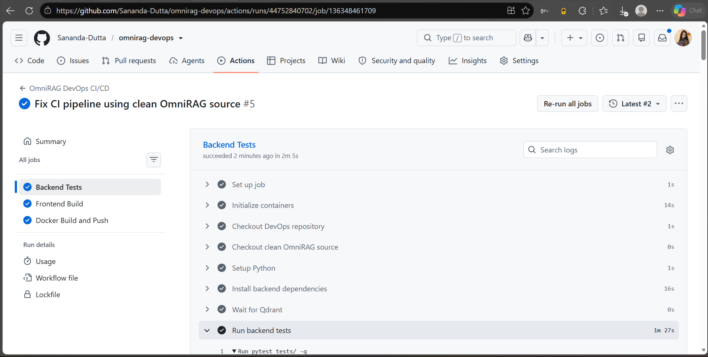
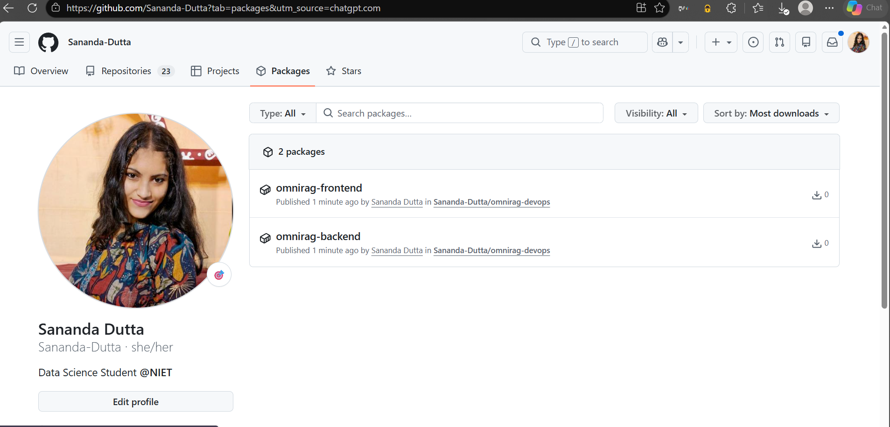
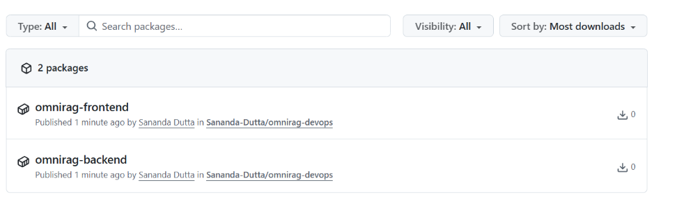
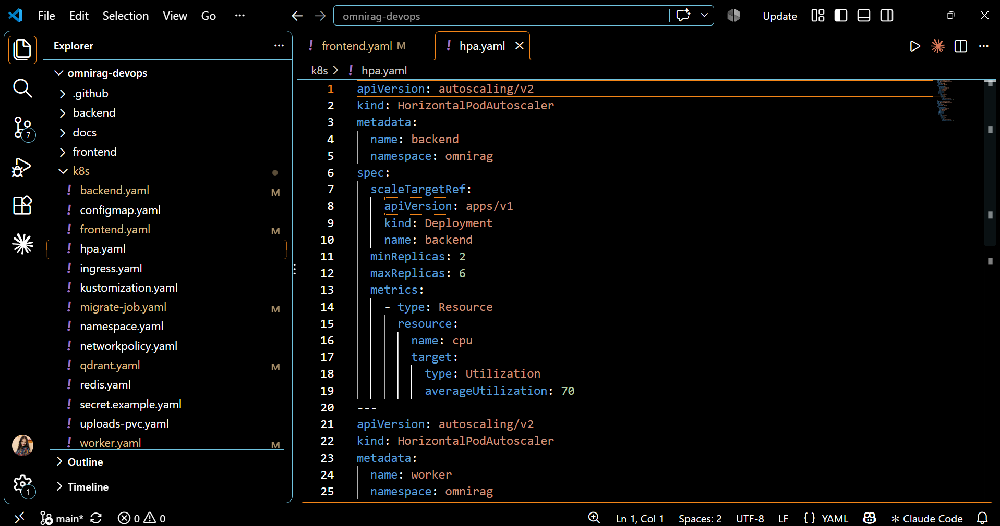
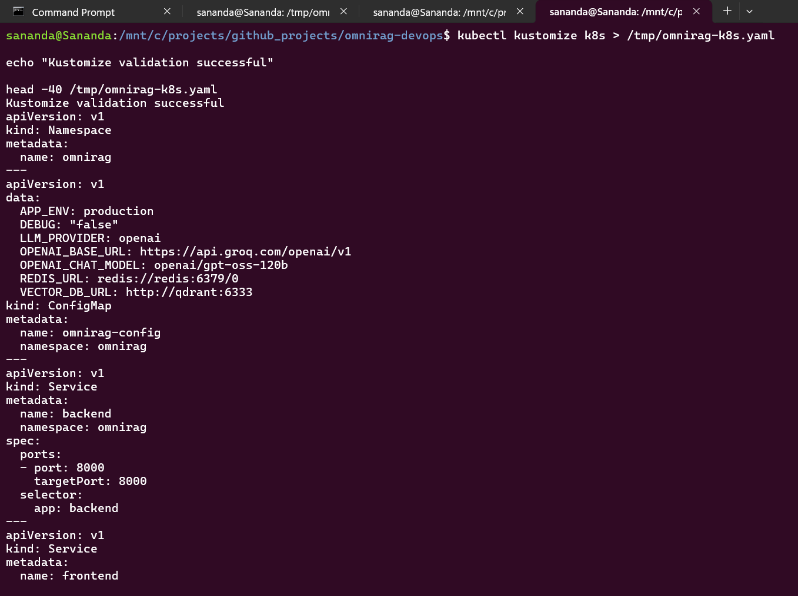

# 🚀 OmniRAG DevOps

### Automating Builds, Testing & Containerization for OmniRAG

<p align="center">
  
  
  
  
</p>

<p align="center">
  <b>A DevOps implementation focused on automating software validation, building Docker images, publishing container artifacts, and preparing a scalable Kubernetes deployment architecture for OmniRAG.</b>
</p>

<p align="center">
  <a href="https://github.com/Sananda-Dutta/Omnirag">Application Repository</a> •
  <a href="https://github.com/Sananda-Dutta/omnirag-devops">DevOps Repository</a>
</p>

---

## 📌 Table of Contents

- [Overview](#-overview)
- [Project Highlights](#-project-highlights)
- [Architecture](#-architecture)
- [Technology Stack](#-technology-stack)
- [CI/CD Pipeline](#-cicd-pipeline)
- [Docker Images](#-docker-images)
- [Kubernetes Architecture](#-kubernetes-architecture)
- [Google Cloud Platform Evaluation](#-google-cloud-platform-evaluation)
- [Repository Structure](#-repository-structure)
- [Getting Started](#-getting-started)
- [Screenshots](#-screenshots)
- [Current Implementation Status](#-current-implementation-status)
- [Future Improvements](#-future-improvements)

---

## 🎯 Overview

**OmniRAG DevOps** is the DevOps implementation for [OmniRAG](https://github.com/Sananda-Dutta/Omnirag), a Retrieval-Augmented Generation (RAG) application.

The objective is to establish an automated and repeatable software delivery workflow using modern DevOps tools.

The implementation focuses on:

- Version control and source code management using Git and GitHub.
- Containerization of the frontend and backend using Docker.
- Automated testing and build validation using GitHub Actions.
- Publishing Docker images to GitHub Container Registry (GHCR).
- Preparing Kubernetes manifests for scalable application deployment.
- Evaluating Google Cloud Platform (GCP) for future cloud infrastructure.

## ✨ Project Highlights

| Feature | Description |
|---|---|
| Automated CI | Backend tests and frontend build validation |
| Dockerization | Separate frontend and backend container images |
| Image Registry | Published images on GitHub Container Registry |
| Kubernetes | Deployment, services, storage, scaling and networking manifests |
| Configuration | Kubernetes ConfigMaps and Secret templates |
| Scalability | Horizontal Pod Autoscaler configuration |
| Cloud Evaluation | GCP architecture evaluation |

## 🏗️ Architecture

The project separates application source code from DevOps configuration.

The GitHub Actions workflow checks out the application repository, validates the backend and frontend, and builds container images. Successful images are published to GHCR.

### CI/CD architecture



### Application architecture

The OmniRAG application consists of:

- **React:** User interface.
- **FastAPI:** Backend API and application logic.
- **PostgreSQL:** Structured application data.
- **Qdrant:** Vector storage and similarity search.
- **Redis:** Background task messaging.
- **Celery:** Asynchronous document processing.
- **External LLM and embedding services:** Context retrieval and response generation.

---

## 🛠️ Technology Stack

| Category | Technologies |
|---|---|
| Version Control | Git, GitHub |
| Containerization | Docker, Docker Compose |
| CI/CD | GitHub Actions |
| Container Registry | GitHub Container Registry |
| Orchestration | Kubernetes |
| Configuration Management | Kubernetes YAML, Kustomize |
| Cloud Evaluation | Google Cloud Platform |
| Application Backend | Python, FastAPI |
| Application Frontend | React, TypeScript |
| Databases | PostgreSQL, Qdrant, Redis |

---

## ⚙️ CI/CD Pipeline

The project uses GitHub Actions to automate code validation and container image publishing.

**Workflow triggers:**
- Push to `main`
- Pull requests
- Manual workflow execution

### Pipeline stages

<details>
<summary><b>1. Backend Testing</b></summary>

- Sets up Python 3.12.
- Starts PostgreSQL, Redis and Qdrant service containers.
- Installs backend dependencies.
- Executes automated tests using `pytest`.

**Purpose:** Detect backend bugs and integration issues before image creation.

</details>

<details>
<summary><b>2. Frontend Build</b></summary>

- Sets up Node.js 22.
- Installs dependencies using `npm ci`.
- Runs TypeScript validation using `npx tsc -b`.
- Builds the production frontend using `npm run build`.

**Purpose:** Validate frontend code and ensure a successful production build.

</details>

<details>
<summary><b>3. Docker Build and Publish</b></summary>

After the backend and frontend jobs pass:

- Builds the backend Docker image.
- Builds the frontend Docker image.
- Publishes the images to GitHub Container Registry on successful pushes to `main`.

**Purpose:** Produce reusable container images for future deployment.

</details>

### Workflow status

[](https://github.com/Sananda-Dutta/omnirag-devops/actions/workflows/ci-cd.yml)

The configured workflow has successfully completed all three jobs: Backend Tests, Frontend Build, and Docker Build and Push.

---

## 🐳 Docker Images

The project builds and publishes two separate Docker images.

| Component | Image |
|---|---|
| Backend | `ghcr.io/sananda-dutta/omnirag-backend:latest` |
| Frontend | `ghcr.io/sananda-dutta/omnirag-frontend:latest` |

Pull the images:

```bash
docker pull ghcr.io/sananda-dutta/omnirag-backend:latest

docker pull ghcr.io/sananda-dutta/omnirag-frontend:latest
```

> Note: Image access depends on the GHCR package visibility and authentication settings.

---

## ☸️ Kubernetes Architecture

The repository includes Kubernetes manifests designed to support a containerized OmniRAG deployment.

### Included resources

| Resource | Purpose |
|---|---|
| Namespace | Isolates application resources |
| Deployments | Runs frontend, backend and worker containers |
| StatefulSet | Manages Qdrant |
| Services | Enables internal service communication |
| ConfigMap | Stores non-sensitive configuration |
| Secret template | Defines required sensitive configuration |
| Persistent Volume Claims | Provides persistent storage |
| HPA | Enables horizontal pod autoscaling |
| Ingress | Defines external application access |
| NetworkPolicies | Controls pod-to-pod communication |
| Migration Job | Provides a database migration workload |

### Validate Kubernetes manifests

Install `kubectl` and ensure the Kubernetes manifests are available locally.

```bash
kubectl kustomize k8s
```

To save the rendered configuration:

```bash
kubectl kustomize k8s > /tmp/omnirag-k8s.yaml
```

> **Deployment status:** Kubernetes manifests have been prepared and successfully rendered. They are not currently claimed to be deployed on a live Kubernetes cluster.

A production deployment will also require appropriate cluster configuration, storage support, secrets, database connectivity, an Ingress controller and other infrastructure dependencies.

---

## ☁️ Google Cloud Platform Evaluation

Google Cloud Platform is evaluated as a potential cloud platform for hosting OmniRAG.

| Requirement | Proposed GCP Service |
|---|---|
| Kubernetes | Google Kubernetes Engine (GKE) |
| Container Registry | Artifact Registry |
| PostgreSQL | Cloud SQL |
| Redis | Memorystore |
| Shared File Storage | Filestore |
| Monitoring | Cloud Monitoring |
| Logging | Cloud Logging |
| Load Balancing | Google Cloud Load Balancing |
| Secrets | Secret Manager |

### Why GCP?

- Managed Kubernetes through GKE.
- Scalable compute and container infrastructure.
- Managed database and caching services.
- Integrated monitoring and logging.
- IAM-based access management and secret protection.

These services provide a possible foundation for a scalable cloud deployment. The GCP architecture is an evaluation and proposal, not a claim of an existing production deployment.

---

## 📂 Repository Structure

```text
omnirag-devops/
│
├── .github/
│   └── workflows/
│       └── ci-cd.yml
│
├── backend/
│   ├── Dockerfile
│   └── .dockerignore
│
├── frontend/
│   ├── Dockerfile
│   ├── .dockerignore
│   └── Caddyfile
│
├── k8s/
│   ├── namespace.yaml
│   ├── configmap.yaml
│   ├── secret.example.yaml
│   ├── backend.yaml
│   ├── frontend.yaml
│   ├── worker.yaml
│   ├── redis.yaml
│   ├── qdrant.yaml
│   ├── uploads-pvc.yaml
│   ├── hpa.yaml
│   ├── ingress.yaml
│   ├── networkpolicy.yaml
│   ├── migrate-job.yaml
│   └── kustomization.yaml
│
├── docs/
│   ├── DEVOPS.md
│   └── screenshots/
│
└── README.md
```

---

## 🚀 Getting Started

### 1. Clone the repository

```bash
git clone https://github.com/Sananda-Dutta/omnirag-devops.git

cd omnirag-devops
```

### 2. Inspect Docker configurations

```bash
cat backend/Dockerfile

cat frontend/Dockerfile
```

### 3. Validate Kubernetes configuration

```bash
kubectl kustomize k8s
```

### 4. Check the CI/CD workflow

Open:

```text
.github/workflows/ci-cd.yml
```

You can inspect the workflow triggers, testing jobs, build dependencies and image publishing steps.

### 5. View workflow executions

Visit the [GitHub Actions page](https://github.com/Sananda-Dutta/omnirag-devops/actions) to inspect workflow runs and job results.

---

## 📸 Screenshots

Screenshots documenting the actual implementation will be added here.

Create the following directory:

```bash
mkdir -p docs/screenshots
```

Save your screenshots inside this directory and use the corresponding image paths below.

### 1. GitHub Actions – Successful Pipeline

Shows successful execution of backend tests, frontend build and Docker image publishing.



### 2. Backend and Frontend Build Jobs



### 3. Docker Images – GHCR



### 4. Kubernetes Manifests



### 5. Kustomize Validation



---

## 📊 Current Implementation Status

| Component | Status |
|---|---|
| Git and GitHub integration | ✅ Completed |
| Backend automated tests | ✅ Passed |
| Frontend build validation | ✅ Passed |
| Docker image creation | ✅ Completed |
| GHCR image publishing | ✅ Completed |
| Kubernetes manifests | ✅ Prepared |
| Kustomize validation | ✅ Passed |
| Live Kubernetes deployment | ⏳ Not deployed |
| Automated production CD | ⏳ Future improvement |
| GCP infrastructure deployment | ⏳ Proposed |

---

## 🔮 Future Improvements

- Implement automated deployment to GKE.
- Introduce staging and production environments.
- Add Docker image vulnerability scanning.
- Add dependency and security scanning to CI.
- Use immutable image tags instead of relying only on `latest`.
- Implement automated smoke tests after deployment.
- Configure Kubernetes autoscaling and resource limits.
- Integrate centralized logging and monitoring.
- Add automated rollback and release approval mechanisms.
- Improve secrets management and infrastructure automation.

---

## 👨‍💻 Author

**Sananda Dutta**

B.Tech – Data Science

[GitHub Profile](https://github.com/Sananda-Dutta)

**Project:** OmniRAG DevOps

**Application Repository:** [OmniRAG](https://github.com/Sananda-Dutta/Omnirag)

---

<p align="center">
  <b>Built with a focus on automation, reliability, scalability and continuous improvement.</b>
</p>
