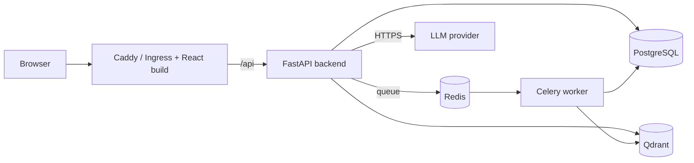
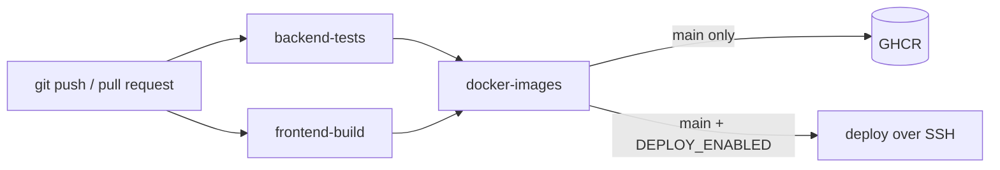

# OmniRAG DevOps

What is implemented, and what is a reference design.

| Area | Tool | Status |
|---|---|---|
| Version control | Git + GitHub | In use |
| Containers | Docker (backend, frontend images), Docker Compose (dev: `docker-compose.yml`, prod: `docker-compose.prod.yml`) | Files written; prod stack not yet run on a server |
| CI/CD | GitHub Actions (`.github/workflows/ci-cd.yml`) | Written; its commands were run locally, the hosted run has not happened yet |
| Server automation | Ansible (`ansible/playbook.yml`) | Syntax-checked, not run against a server |
| Orchestration | Kubernetes manifests (`k8s/`) | Schema-validated, not applied to a cluster |

## Architecture

## CI/CD pipeline

## Where the files go

Copy them into the repository root keeping the same paths, then commit.
Enable the deploy job by setting the repository variable `DEPLOY_ENABLED=true`
and the secrets `DEPLOY_HOST`, `DEPLOY_USER`, `DEPLOY_SSH_KEY`.
